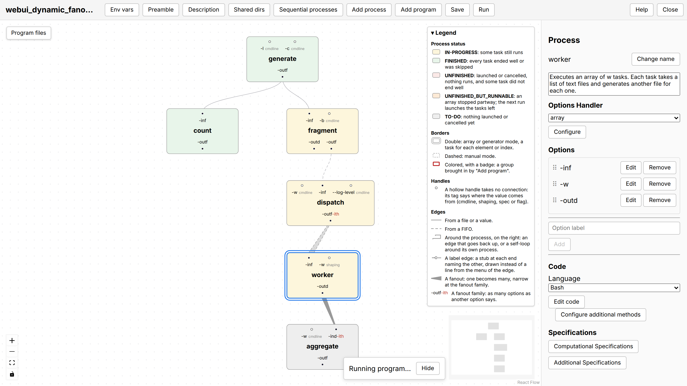

<p align="center">
  <picture>
    <source media="(prefers-color-scheme: dark)"
            srcset="rtdocs/source/images/debasher_logo_readme_dark.svg">
    
  </picture>
</p>

# DeBasher

DeBasher is a workflow system whose processes are Unix programs. Each
process is written in the language its author prefers (Bash, Python, R,
Perl or Groovy), takes its inputs and gives its outputs through named
options, and the way options connect across processes defines the
dependency graph that DeBasher schedules and runs, on one machine or on a
Slurm cluster. Programs are built in a visual editor, with the help of an
AI assistant, written by hand as Bash modules, or described in Python
with the SDK.

<p align="center">
  
</p>

<p align="center"><em>A program running in the web interface: a file is
cut into fragments that a dispatcher streams through FIFOs to a pool of
workers.</em></p>

DeBasher runs two kinds of program. A general program processes a batch of
inputs and ends. A resident program processes a stream: long-lived,
stateful processes exchange messages through FIFOs, in cycles when needed,
survive crashes, and can launch a general program for each request they
receive. Both kinds define their processes the same way.

DeBasher follows flow-based programming and keeps what the shell does
best: a process is a black box with a command-line interface, so any
program that takes its inputs and leaves its outputs through options,
files or FIFOs can be one.

Among its features:

- cycles between processes, and interactive workflows;
- stateful processes, with crash recovery, snapshots, and orderly stop and
  resume;
- a built-in scheduler, and Slurm for clusters;
- Conda environments and Docker containers for reproducibility;
- a visual editor to build, run and observe programs from a browser, with
  AI assistance;
- programs saved as a readable `program.yaml` and one file per process,
  which the editor, the Python SDK, an AI agent or a text editor all
  write, and git versions.

## A program in Python

A program can also be described in Python with the SDK. This one has two
processes: `write` writes a greeting into a file, and `shout`, which
reads that file, writes it in capitals. Connecting the input of `shout`
to the output of `write` is all it takes for `shout` to run after it:

```python
from debasher import Process, Program, in_outdir

write = Process("write", code="write.sh", description="Writes a greeting.")
write.cmdline_opt("-name", "string", "who to greet")
write.output("-outf", "file", "the greeting", value=in_outdir("greeting.txt"))

shout = Process("shout", code="shout.py", description="Turns it into capitals.")
shout.input("-inf", "file", "the greeting", source=write["-outf"])
shout.output("-outf", "file", "the result", value=in_outdir("shout.txt"))

prg = Program("greet")
prg.add(write, cpus=1, mem=32, time="00:01:00")
prg.add(shout, cpus=1, mem=32, time="00:01:00")
```

Each process keeps its code in a file of its own language, and gets its
options on its command line. `write.sh` is a Bash function:

```bash
write()
{
    local name=$(read_opt_value_from_func_args "-name" "$@")
    local outf=$(read_opt_value_from_func_args "-outf" "$@")
    echo "Hello, ${name}!" > "${outf}"
}
```

and `shout.py` an ordinary Python script:

```python
import argparse

parser = argparse.ArgumentParser()
parser.add_argument("-inf")
parser.add_argument("-outf")
args = parser.parse_args()
with open(args.inf) as inf, open(args.outf, "w") as outf:
    outf.write(inf.read().upper())
```

`debasher_build` writes the program beside the description, as the
editor saves it, and `debasher_exec` runs it:

```bash
debasher_build greet.py
debasher_exec --pfile greet.sh --outdir out -name World --wait
cat out/shout/shout.txt      # HELLO, WORLD!
```

The directory now holds `program.yaml`, which the web interface opens
with "Load program", and `greet.sh`, the module that `debasher_exec`
runs. The same program could have been drawn in the editor, or written by
hand as a Bash module; see the
[documentation](https://debasher.readthedocs.io/en/latest/implem.html).

## Try it

The quickest way to see DeBasher is its Docker demo image, which packs the
engine and the web interface into one container, with the example programs
inside:

```bash
git clone https://github.com/daormar/debasher.git
cd debasher
chmod 777 demo-data
docker compose up --build -d            # build and start, on port 8000
docker compose exec debasher webui-url  # print its address

# To stop it, freeing port 8000:
docker compose down
```

The `webui-url` command prints the address of the web interface, which
carries its token; open it in a browser. The image is for trying DeBasher
out, not for real work: inside it, processes cannot have Conda environments
or Docker containers of their own, and there is no Slurm.
[DOCKER.md](DOCKER.md) has the details, and how to run Claude Code inside the
container.

## Installation

To install DeBasher itself:

```bash
git clone https://github.com/daormar/debasher.git
cd debasher
./reconf
./configure --prefix=<installation-directory>
make
make install
```

DeBasher runs on Linux, macOS and on Windows under WSL2; see the
[installation instructions](https://daormar.github.io/debasher/#installation)
for its requirements and for each system.

## Project information

- [Web page](https://daormar.github.io/debasher/)
- [Technical documentation](https://debasher.readthedocs.io/en/latest/)
- [Journal article](https://bmcbioinformatics.biomedcentral.com/articles/10.1186/s12859-025-06108-1)

## License and citation

DeBasher is released under the GNU Lesser General Public License, version 3.
If you use it in your research, please cite: Ortiz-Martínez, D. DeBasher: a
flow-based programming bash extension for the implementation of complex and
interactive workflows with stateful processes. BMC Bioinformatics 26, 106
(2025). https://doi.org/10.1186/s12859-025-06108-1
