Getting Started
===============

Installing DeBasher and use it to implement a simple program is very
easy as it is shown below.

.. _installation:

Installation
------------

DeBasher is developed on Linux, and tested on Linux, on macOS and on
Windows through WSL2, which runs a Linux system inside Windows: on
each of them every change is built and its tests run. The
requirements are listed first, then how to meet them on each system,
and then how to build and install the package, which is the same
everywhere.

Requirements
^^^^^^^^^^^^

* Bash 4.3 or newer, which runs every script of DeBasher.
* Python 3.
* The usual command line tools of a Linux system: those of GNU
  coreutils (``realpath`` and ``timeout`` among them), ``grep``,
  ``sed``, ``awk`` and ``find``, and ``flock``, from util-linux.
* Graphviz, whose ``dot`` command draws the graphs of programs.
* ``ps`` (from procps on Linux), which nearly every system has but some
  containers lack. It is optional: without it, ``debasher_exec`` warns
  on every run with the built-in scheduler, since it can then tell a
  task from a later process that gets the same process id only by the
  completion marker of the task. Install procps (for example ``apt
  install procps``) to remove the warning.
* The autotools, to configure the package: autoconf 2.71 or newer and
  automake; and ``make``, to build it.
* For the web interface, which is optional (see the :ref:`webui`
  Section): Node.js 22.12 or newer, with npm, to build it, and a
  Python virtual environment for its server. Without npm,
  ``configure`` leaves the web interface out, as it does when given
  ``--disable-frontend``.

Some features need further software, described in `Third Party
Software`_ below.

Linux
^^^^^

On Ubuntu (or Debian), the required packages are installed with:

::

    $ sudo apt install autoconf automake make git graphviz python3 python3-venv

Bash, coreutils and util-linux are part of every installation. The
Node.js package of the distribution is usually older than 22.12; a
newer one is installed from `nodejs.org <https://nodejs.org/>`__ or
with `nvm <https://github.com/nvm-sh/nvm>`__. Other distributions have
packages of the same names, or close to them.

Windows
^^^^^^^

DeBasher runs inside WSL2, the Linux system of Windows, and is tested
there with Ubuntu 24.04. WSL2 is installed, with an Ubuntu
distribution, from a PowerShell opened as administrator:

::

    > wsl --install

Then, in a terminal of that Ubuntu, follow the instructions for Linux
above. Keep the sources of DeBasher, your programs and their output
directories in the file system of Linux (under your home directory
there), not in the drives of Windows that WSL2 mounts under
``/mnt/c``: DeBasher creates FIFOs and locks files, which those drives
may not support, and reaching them from Linux is much slower. The web
interface, started inside WSL2, is reached from a browser of Windows
at ``http://localhost:8000/``, since WSL2 forwards the ports of
``localhost`` to Windows.

macOS
^^^^^

The steps below install everything that DeBasher needs, and make the
command line tools that it finds behave as those of Linux do. They are
the steps with which DeBasher is tested on macOS 15, on Apple silicon.
If something fails, please report it on the `issues page
<https://github.com/daormar/debasher/issues>`__ of the project.

#. Install the command line tools of Xcode, which provide ``git`` and
   ``make``:

   ::

       $ xcode-select --install

#. Install `Homebrew <https://brew.sh/>`__, and with it the rest of
   the requirements:

   ::

       $ brew install bash coreutils findutils gnu-sed grep gawk flock \
           autoconf automake graphviz python node

   macOS ships Bash 3.2 and has no ``flock``, and its ``sed``, ``grep``,
   ``find`` and the tools of coreutils are those of BSD, which differ
   in details from the GNU ones that DeBasher is tested with.

#. Put the Bash of Homebrew and the GNU tools first in the ``PATH``,
   under their usual names (Homebrew installs the GNU tools with a
   ``g`` prefix, ``gsed`` or ``gtimeout``, and keeps the usual names in
   ``gnubin`` directories), for example in ``~/.zprofile``:

   ::

       BREW="$(brew --prefix)"
       export PATH="$BREW/opt/coreutils/libexec/gnubin:$BREW/opt/findutils/libexec/gnubin:$BREW/opt/gnu-sed/libexec/gnubin:$BREW/opt/grep/libexec/gnubin:$BREW/bin:$PATH"

   ``configure`` takes the first ``bash`` of the ``PATH``, which every
   script of DeBasher then runs with, and refuses one older than 4.3;
   ``bash --version`` shows which one comes first.

#. Build and install the package as described below, and run
   ``make installcheck``, which runs the examples of DeBasher and says
   whether they work.

Mirror taps (the ``--mirror`` option of ``define_fifo_opt``) rely on
how Linux and macOS treat a FIFO opened for both reading and writing.
On macOS, a mirror tap whose reader is gone takes a second longer to
stop.

Building and Installing
^^^^^^^^^^^^^^^^^^^^^^^

Once the requirements are available, the package is built and
installed with the following steps:

#. Obtain the package using git:

   ::

   $ git clone https://github.com/daormar/debasher.git

   Or `download it in a zip
   file <https://github.com/daormar/debasher/archive/master.zip>`__

#. ``cd`` to the directory containing the package's source code
   and type ``./reconf``.

#. Type ``./configure`` to configure the package.

#. Type ``make`` to compile the package.

#. Type ``make install`` to install the programs and any data
   files and documentation.

#. Optionally, type ``make installcheck`` to check the installation:
   it runs the example programs with the installed tools. The examples
   described with the Python SDK are skipped unless ``debasher_build``
   finds a Python with pydantic 2, the one of an activated virtual
   environment, the one that ``DEBASHER_WEBUI_PYTHON`` names or the one
   found when DeBasher was configured, and the Conda and Docker examples
   are skipped without Conda or Docker.

#. You can remove the program binaries and object files from the
   source code directory by typing ``make clean``.

By default the files are installed under the ``/usr/local`` directory
(or similar, depending on the OS you use); however, since Step 5
requires root privileges, another directory can be specified during Step
3 by typing:

::

    $ ./configure --prefix=<absolute-installation-path>

For example, if ``user1`` wants to install the DeBasher package in
the directory ``/home/user1/debasher``, the sequence of commands to
execute should be the following:

::

    $ ./reconf
    $ ./configure --prefix=/home/user1/debasher
    $ make
    $ make install

The installation directory can be the same directory where the
DeBasher package was decompressed.

Third Party Software
^^^^^^^^^^^^^^^^^^^^

Slurm
"""""

DeBasher can be configured to use `Slurm <https://slurm.schedmd.com/>`__
as a workload scheduler.  Slurm is particularly indicated to execute
large pipelines or to execute pipelines in high performance computing
environments.

Conda
"""""

DeBasher provides support for automated installation of `Conda
<https://conda.io/>`__ packages. Such packages are organized in
environments and (optionally) used within DeBasher software modules.

Docker
""""""

DeBasher also provides support for `Docker <https://www.docker.com/>`__
containers, favoring reproducibility of results.

Other languages
"""""""""""""""

A process written in R, Perl or Groovy runs with the interpreter that
``configure`` found on the ``PATH`` (``Rscript``, ``perl``,
``groovy``), or with the one given as ``./configure RSCRIPT=<path>``
(``PERL``, ``GROOVY``). A module with such a process loads without its
interpreter, but ``debasher_exec`` refuses to run it (see the
:ref:`implem_bash` Section).

.. _quickstart:

Quickstart
----------

The quickest way to a first program is the web interface: this section
builds a program that prints "Hello World!", runs it and looks at what
it printed, without writing any Bash. The same program is shipped with
DeBasher as ``webui_hello_world``, among the examples that "Load
program" opens, and its hand-written version opens the :ref:`implem_bash`
Section.

Once the Python dependencies of the web interface are installed (see
the :ref:`webui` Section), it is started with:

::

    $ debasher_webui

which prints the address to open in a browser, such as
``http://127.0.0.1:8000/#token=...``. The address holds the token of
the server, so open it as it is printed. The home screen offers three
ways to open a program; choose "Create new program".

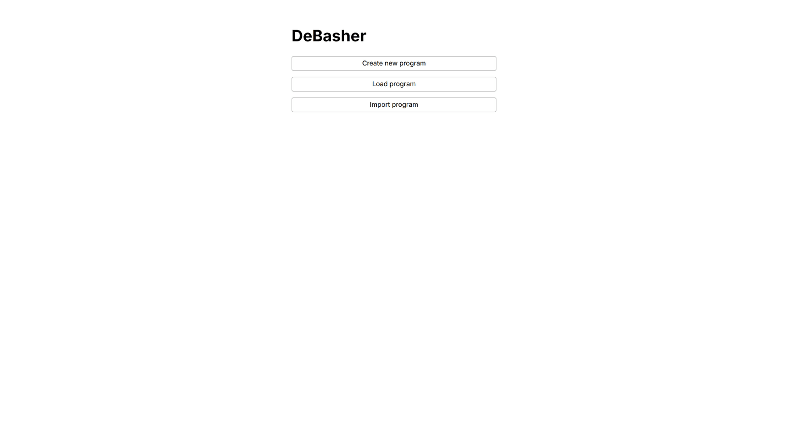

Give the program a name, ``webui_hello_world``, keep its type, a
general program, and press "Create".

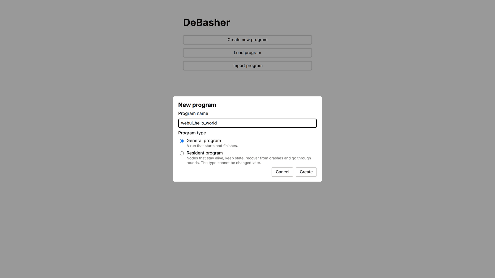

The editor opens on an empty canvas, with a toolbar above it and, on
the right, the Inspector, which shows the selected process. "Add
process" asks for the name of the new process, ``hello_world``.

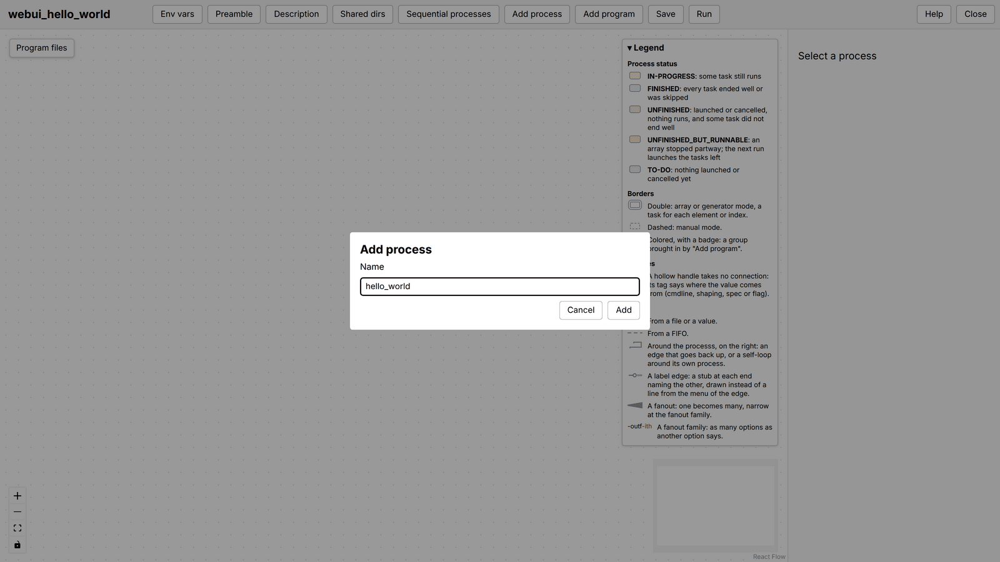

The process appears on the canvas as a box, selected, and the
Inspector shows it: its name, a description to fill in ("Prints a
greeting."), its options, none yet, its code and its specifications.

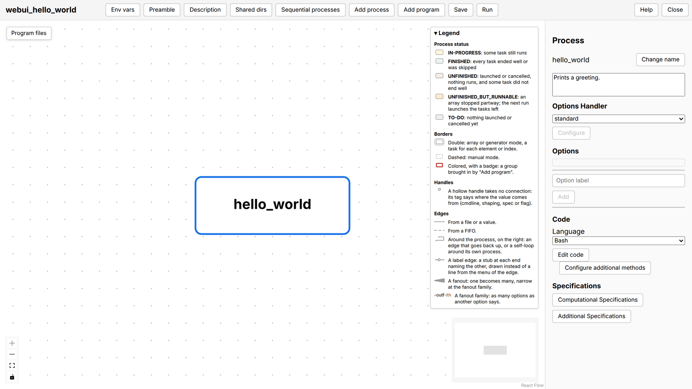

The process takes the string to print through an option. Under
"Options", type its label, ``-s``, in "Option label" and press "Add":
the option editor opens. Set its data type to string, describe it
("string to print ('Hello World!' by default)"), tick "Command line",
since the string is given when the program is run, and leave
"Mandatory" unticked, so that the program runs without it; then press
"Save".

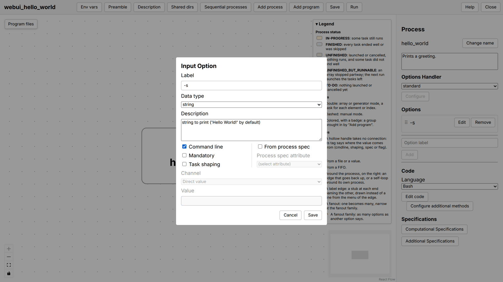

The box of the process now shows ``-s`` with a hollow handle tagged
``cmdline``: an option that comes from the command line takes no
connection from another process. "Edit code", under "Code", opens the
code editor with a template that reads every option; replace it with
the code of the process:

.. code-block:: bash

    hello_world()
    {
        local s=$(read_opt_value_from_func_args "-s" "$@")
        if [ "${s}" = "${DEBASHER_OPT_NOT_FOUND}" ]; then
            s="Hello World!"
        fi

        echo "${s}"
    }

A process written in Bash is a function with the name of the process,
which the engine calls with the options of the process as its
arguments. ``read_opt_value_from_func_args`` reads the value of an
option among them, and gives ``${DEBASHER_OPT_NOT_FOUND}`` when the
option was not given, which is when the default applies. Press "Save"
in the code editor.

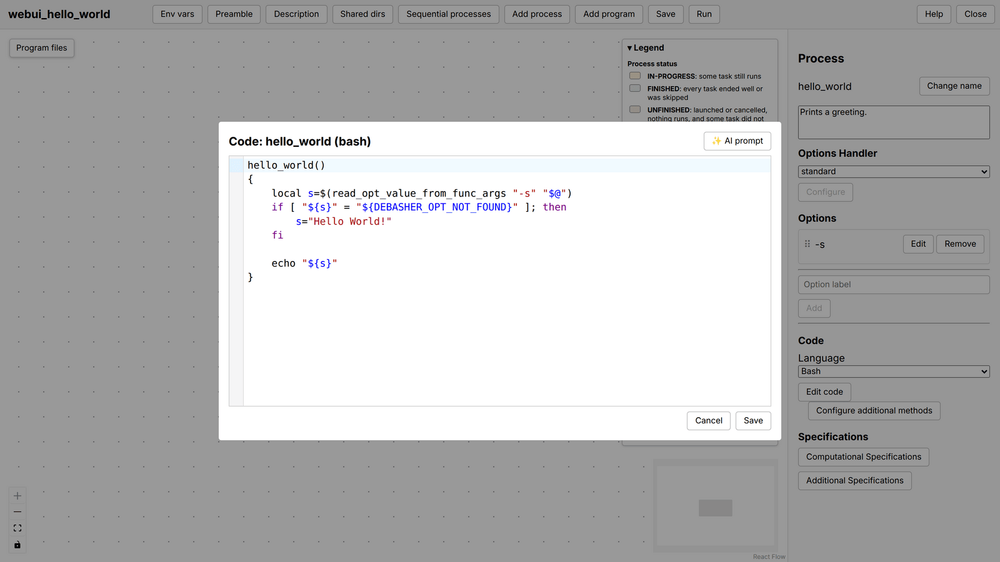

"Save" in the toolbar asks for the home directory of the program, a
directory of your own, new or empty, and writes the program there: the
program as the editor keeps it, a topology file ``program.yaml`` and
the code of the process in ``hello_world.sh``, and the module that the
editor generates from them, ``webui_hello_world.sh``.

The "Run" menu of the toolbar runs the program. First "Set output
directory", the directory where the run leaves what its processes
write, which is not the home directory of the program; "Set program
options" would give ``-s`` another string, and is not needed here;
then "Run program".

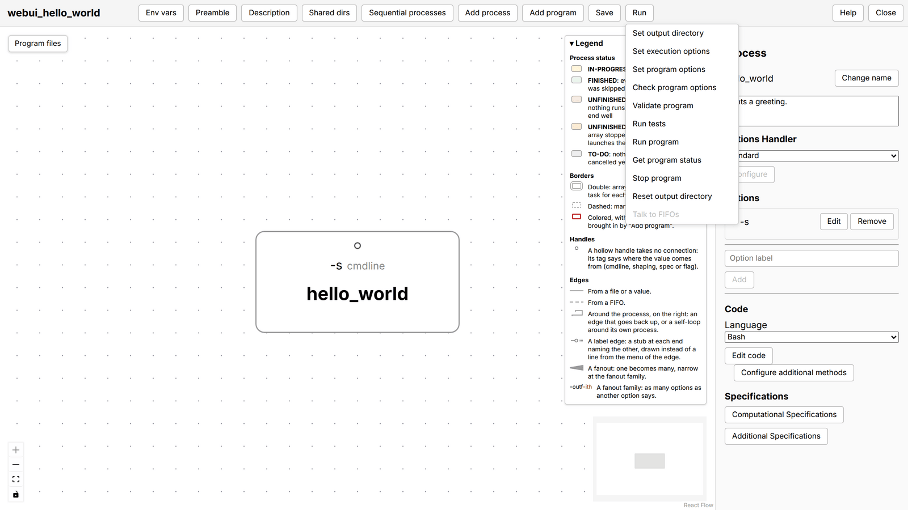

The process turns yellow while it runs and green when it has finished,
as the legend of the canvas says, and an indicator in the corner
follows the run.

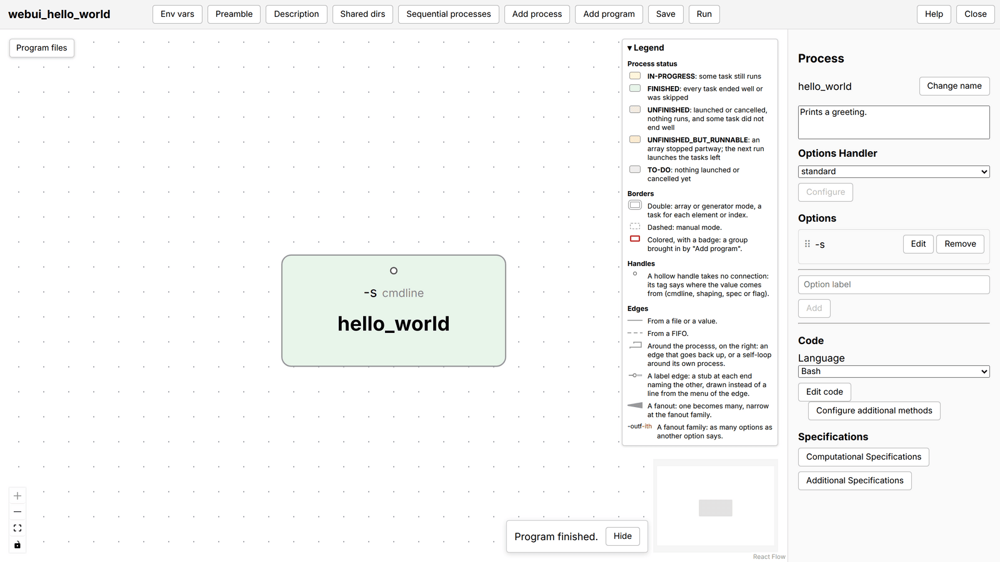

What the process printed is in the output directory. The right-button
menu of the process shows what it left there: "Show stdout" opens it.

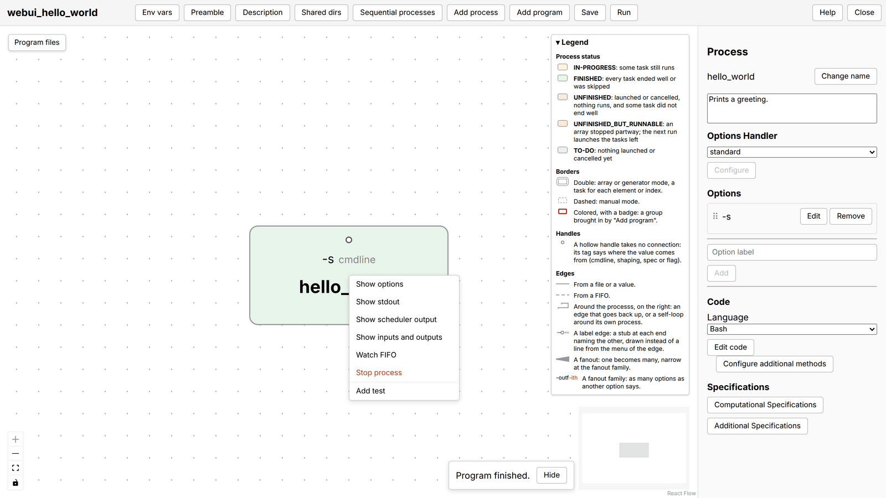

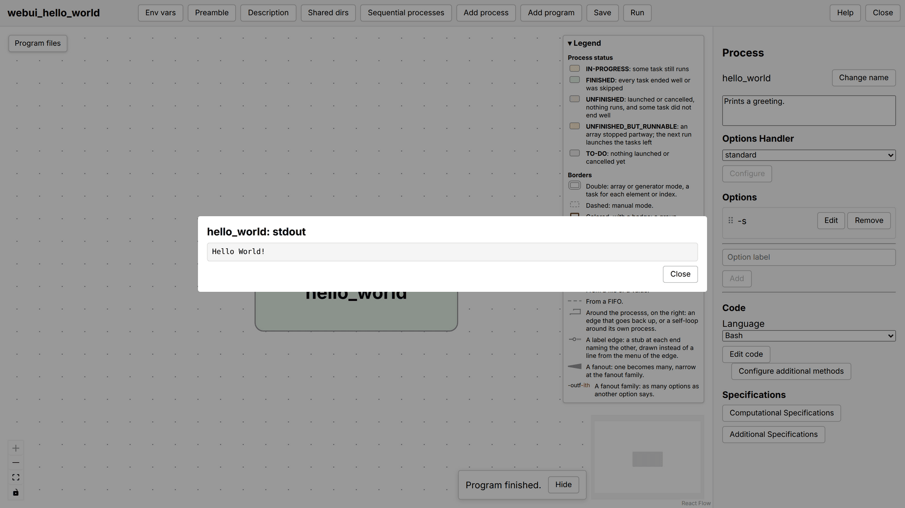

The module that the editor wrote into the home directory is a Bash
file that DeBasher runs as it runs any module, from the command line
too (see the :ref:`exec` Section):

::

    $ debasher_exec --pfile webui_hello_world.sh --outdir out -s "Hello from the shell"

Its content is what the :ref:`implem_bash` Section explains how to write by
hand; the editor wrote it from the drawing:

.. literalinclude:: ../../data/webui_programs/webui_hello_world/webui_hello_world.sh
   :language: bash

The same process in Python
^^^^^^^^^^^^^^^^^^^^^^^^^^

A process is a Unix program, so its language is a choice of its
author, made in the Inspector: set "Language", under "Code", to
Python, and "Edit code" opens the code editor on a template that is
now a whole Python program, which reads ``-s`` with ``argparse``. The
engine runs such a process with ``python3`` and the options of the
process as its command line arguments, so the code of the process is:

.. code-block:: python

    import argparse

    parser = argparse.ArgumentParser()
    parser.add_argument("-s", default="Hello World!")
    args = parser.parse_args()
    print(args.s)

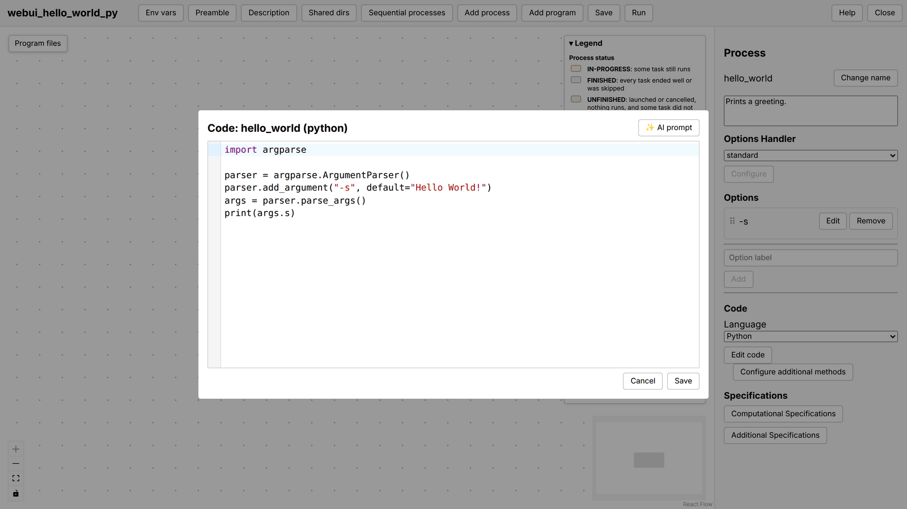

Nothing else changes: the option, the saving (which now writes the code
in ``hello_world.py``), the run and the output are the same, and so is
the module that the editor writes, except that it no longer holds the
code of the process: it runs ``hello_world.py`` as it is, through the
external alias of the :ref:`implem_bash` Section, with a path relative
to its own directory, so that the module and the files of the processes
go together:

.. literalinclude:: ../../data/webui_programs/webui_hello_world_py/webui_hello_world_py.sh
   :language: bash
   :start-at: webui_hello_world_py_program()
   :end-at: }

The module stays a Bash file whatever the processes are written in:
Bash is the glue that holds a program together and that any Unix
machine runs, and the processes are the programs of their authors.
This version is shipped as ``webui_hello_world_py``, and its
hand-written counterpart is :doc:`hello_world_ext_alias`
(:doc:`hello_world_py` writes the same process with its code inside the
module, a form the engine also accepts). The same program
described in Python with the SDK opens the :ref:`implem_python`
Section.

From here, the :ref:`concepts` Section says what a program is made of,
and the :ref:`webui` Section describes every part of the editor,
including how processes are connected, which is what a program with
more than one process adds to this one.
